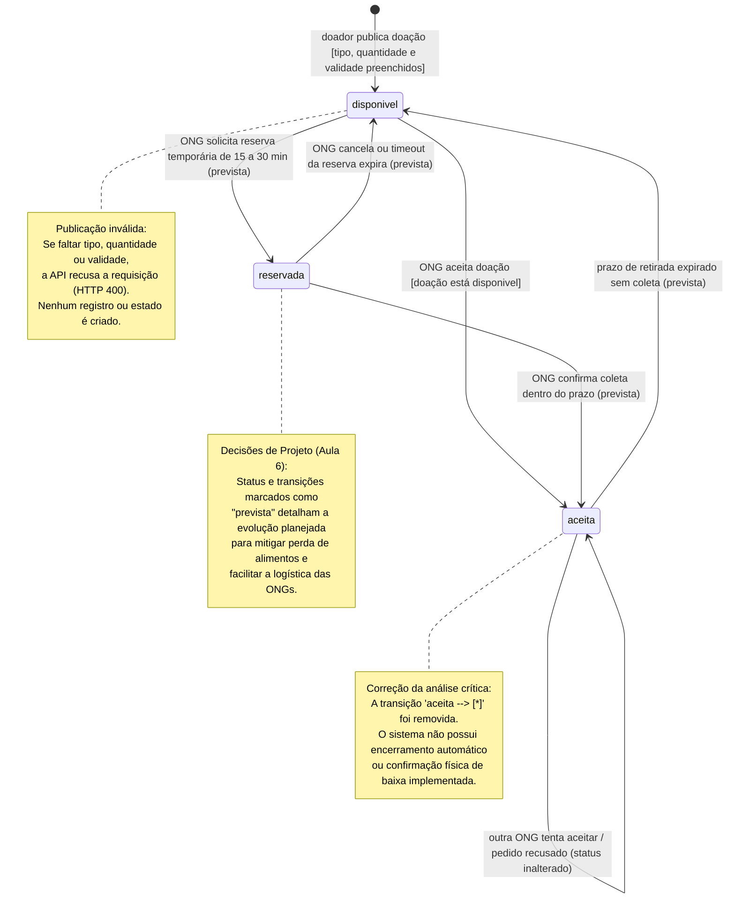

# Diagrama de Estados da Doação — Versão Final Evoluída

> **Versão evoluída e corrigida por Leonardo Lotério de Lima (@leonardosth).**  
> Este documento representa a versão final do Diagrama de Estados do ciclo de vida de uma doação no **Prato Cheio**, incorporando as correções apontadas na [análise crítica](analise-critica.md) sobre a [versão inicial gerada pela IA](ia-original/estados-doacao.md) e alinhando-se às regras de negócio e decisões de projeto da Aula 6.

| Item | Valor |
|---|---|
| **Responsável pela evolução** | Leonardo Lotério de Lima (@leonardosth) |
| **Data da revisão** | 24/10/2026 |
| **Origem da versão inicial** | Claude Sonnet 5.5 (`ia-original/estados-doacao.md`) |
| **Referência crítica** | `docs/diagramas/analise-critica.md` (Problemas 1 e 2) |
| **Formato e modelagem** | Mermaid (UML State Diagram v2) versionado no GitHub |

---

## 1. Correções e Melhorias Aplicadas

Com base na análise crítica realizada pelo grupo ([analise-critica.md](analise-critica.md)), as seguintes correções foram incorporadas ao modelo:

1. **Remoção da finalização prematura (`aceita --> [*]`):**
   - *Problema original:* A IA havia incluído uma transição direta do estado `aceita` para o estado final (`[*]`).
   - *Correção aplicada:* Essa transição foi **removida**. O escopo atual do sistema possui apenas os status `disponivel` e `aceita`. Não existe ainda uma rota ou fluxo de confirmação física de entrega/baixa. Manter o estado final transmitia a impressão errônea de que o sistema realizava um encerramento automático. A doação permanece no estado `aceita` até que ocorra uma eventual expiração por timeout (decisão prevista).

2. **Representação explícita da condição de guarda na publicação:**
   - *Problema original:* A criação da doação não deixava claro o que ocorre quando a requisição não contém todos os dados obrigatórios.
   - *Correção aplicada:* Foi adicionada condição de guarda explícita `[campos obrigatórios preenchidos: tipo, quantidade e validade]` na transição inicial. Foi documentado formalmente via nota que tentativas de publicação sem esses dados são rejeitadas com erro (`HTTP 400`) e **não geram** entidade ou estado no sistema.

3. **Consolidação das transições previstas (Decisões de Projeto da Aula 6):**
   - Foram mantidos e destacados os fluxos decorrentes das Decisões 1 e 2 da Aula 6:
     - **Decisão 1 (Miguel Huertas):** Retorno de `aceita` para `disponivel` caso a ONG não retire o alimento dentro do prazo estipulado (evitando comida estragada e doação presa).
     - **Decisão 2 (Leonardo Lima):** Introdução do estado intermediário `reservada`, permitindo que a ONG obtenha uma janela de exclusividade (15 a 30 minutos) para planejar transporte/voluntários antes de efetivar o aceite definitivo.

---

## 2. Diagrama de Estados (Mermaid)

---

## 3. Detalhamento dos Estados e Transições

### Estados Atuais do Sistema

- **`disponivel`:**  
  Estado inicial da doação cadastrada com sucesso. Fica visível para listagem pública de todas as ONGs através de `GET /api/doacoes`.
- **`aceita`:**  
  Estado em que a doação passa a ter um vínculo exclusivo com uma determinada ONG (`ong` preenchida). Ela deixa de ser listada na rota de disponíveis e recusa novas tentativas de aceite.

### Transições Atuais

- **`[*] --> disponivel`:**  
  Disparada pelo endpoint `POST /api/doacoes`. Requer os três atributos (`tipo`, `quantidade`, `validade`). Falhas de validação disparam erro `400` e não criam estado.
- **`disponivel --> aceita`:**  
  Disparada por `POST /api/doacoes/:id/aceitar`. Executada de forma atômica no banco (`UPDATE ... WHERE status = 'disponivel'`).
- **`aceita --> aceita` (Auto-transição de recusa):**  
  Quando outra ONG tenta submeter um aceite para uma doação que já foi aceita. O sistema recusa a operação e mantém o registro exatamente como estava, vinculado à primeira ONG.

### Estados e Transições Previstas (Evolução da Arquitetura)

- **`reservada` (Decisão 2 - Leonardo Lima):**  
  Evita que a ONG tenha que aceitar "no escuro". Garante exclusividade de 15 a 30 minutos enquanto a instituição verifica motorista e rotas.
- **`reservada --> aceita`:**  
  Confirmação formal da coleta pela ONG que reservou dentro da janela de tolerância.
- **`reservada --> disponivel`:**  
  Cancelamento voluntário pela ONG ou expiração do tempo de reserva.
- **`aceita --> disponivel` (Decisão 1 - Miguel Huertas):**  
  Mecanismo de expiração caso a ONG aceite mas não compareça para retirar, devolvendo o alimento à comunidade antes que estrague.
