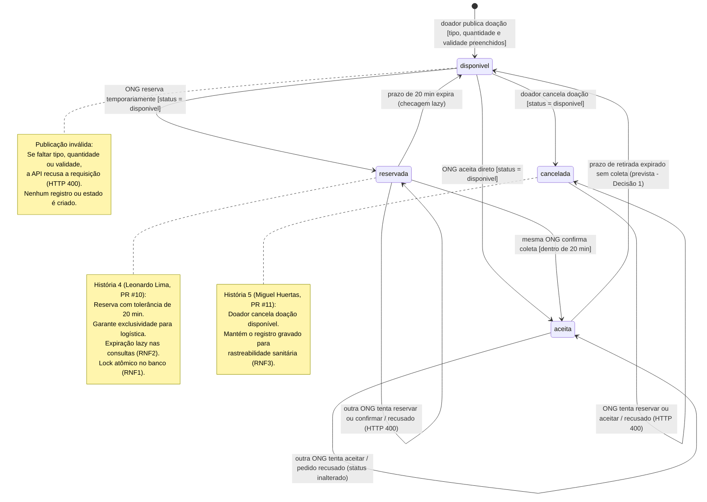

# Diagrama de Estados da Doação — Versão Final Evoluída

> **Versão evoluída e consolidada por Leonardo Lotério de Lima (@leonardosth) para a Entrega 2 (N2).**  
> Este documento representa a versão consolidada do Diagrama de Estados do ciclo de vida de uma doação no **Prato Cheio**, incorporando as correções apontadas na [análise crítica](analise-critica.md) sobre a [versão inicial gerada pela IA](ia-original/estados-doacao.md) e consolidando a implementação das histórias da Entrega 2 (História 4 — Reserva com prazo, e História 5 — Cancelamento pelo doador).

| Item | Valor |
|---|---|
| **Responsável pela evolução** | Leonardo Lotério de Lima (@leonardosth) |
| **Data da revisão** | 28/10/2026 (atualização da Entrega 2) |
| **Origem da versão inicial** | Claude Sonnet 5.5 (`ia-original/estados-doacao.md`) |
| **Referência crítica** | `docs/diagramas/analise-critica.md` (Problemas 1 e 2) e Decisões de Projeto da Aula 6 |
| **Formato e modelagem** | Mermaid (UML State Diagram v2) versionado no GitHub |

---

## 1. Correções e Melhorias Aplicadas

Com base na análise crítica realizada pelo grupo ([analise-critica.md](analise-critica.md)) e na evolução do código na Entrega 2, as seguintes correções e implementações foram incorporadas ao modelo:

1. **Remoção da finalização prematura (`aceita --> [*]`):**
   - *Problema original:* A IA havia incluído uma transição direta do estado `aceita` para o estado final (`[*]`).
   - *Correção aplicada:* Essa transição foi **removida**. O escopo atual do sistema possui apenas operações de reserva, confirmação, aceite e cancelamento. Não existe ainda uma rota ou fluxo de confirmação física de entrega/baixa. A doação permanece no estado `aceita` até que ocorra uma eventual expiração por timeout de retirada (decisão prevista).

2. **Representação explícita da condição de guarda na publicação:**
   - *Problema original:* A criação da doação não deixava claro o que ocorre quando a requisição não contém todos os dados obrigatórios.
   - *Correção aplicada:* Foi adicionada condição de guarda explícita `[campos obrigatórios preenchidos: tipo, quantidade e validade]` na transição inicial. Tentativas de publicação sem esses dados são rejeitadas com erro (`HTTP 400`) e **não geram** entidade ou estado no sistema.

3. **Consolidação do estado `reservada` (História 4 — Leonardo Lotério, PR #10):**
   - *Problema original:* O aceite imediato forçava a ONG a assumir compromisso sem saber se tinha transporte ou motorista pronto, ou perder a doação para outra instituição.
   - *Implementação:* Introdução do estado intermediário `reservada`, que garante exclusividade temporária de 20 minutos à ONG solicitante via `POST /api/doacoes/:id/reservar`.
   - *Expiração Lazy (RNF2):* A expiração da reserva é avaliada de forma "preguiçosa" (*lazy*) em `atualizarExpiradas()`, executada automaticamente nas leituras e escritas sem exigir jobs ou serviços de agendamento em paralelo. Vencido o prazo de 20 minutos, a doação retorna de forma atômica para `disponivel`.
   - *Confirmação:* A mesma ONG que reservou pode confirmar a coleta dentro do prazo via `POST /api/doacoes/:id/confirmar`, transitando para `aceita`.

4. **Consolidação do estado `cancelada` (História 5 — Miguel Huertas, PR #11):**
   - *Problema original:* Uma doação publicada com erro ou cujo alimento estragou ficava presa na lista pública sem possibilidade de revogação pelo doador.
   - *Implementação:* O doador pode cancelar uma doação que ainda esteja `disponivel` via `POST /api/doacoes/:id/cancelar`.
   - *Rastreabilidade sanitária (RNF3):* Em conformidade com a exigência da vigilância sanitária, o cancelamento não remove o registro (`DELETE`), mas altera o status para `cancelada` registrando `cancelada_em` e `motivo_cancelamento`.
   - *Regra de proteção:* Se a doação já estiver com reserva ativa ou aceita, a tentativa de cancelamento é recusada com erro (`HTTP 400`), protegendo a ONG que já mobilizou voluntários.

---

## 2. Diagrama de Estados Atualizado (Mermaid)

---

## 3. Detalhamento dos Estados e Transições

### Estados Implementados no Sistema (Entrega 2)

- **`disponivel`:**  
  Estado inicial da doação cadastrada com sucesso. Fica visível para listagem pública de todas as ONGs através de `GET /api/doacoes` (podendo ser filtrada por tipo, conforme História 6).
- **`reservada` (História 4):**  
  Estado em que uma ONG obtém garantia de exclusividade temporária (20 minutos) para planejar a retirada. O registro guarda `reservada_por` e `reservada_em`.
- **`aceita`:**  
  Estado em que a doação passa a ter um vínculo de coleta definitivo com uma determinada ONG (`ong` preenchida), seja por confirmação de reserva prévia ou por aceite imediato. Ela não é mais listada para o público.
- **`cancelada` (História 5):**  
  Estado em que o doador cancela uma doação disponível que não deve mais ser distribuída. Permanece no banco com `cancelada_em` e `motivo_cancelamento` para fins de auditoria e vigilância sanitária.

### Transições Implementadas e Tratamento de Concorrência

- **`[*] --> disponivel` (`POST /api/doacoes`):**  
  Exige `tipo`, `quantidade` e `validade`. Falhas disparam `HTTP 400`.
- **`disponivel --> reservada` (`POST /api/doacoes/:id/reservar`):**  
  Executa `UPDATE doacoes SET status = 'reservada', reservada_por = ?, reservada_em = ... WHERE id = ? AND status = 'disponivel'`. Se duas ONGs tentarem reservar ao mesmo tempo, apenas a primeira altera linha (`changes === 1`); a segunda recebe `HTTP 400`.
- **`reservada --> aceita` (`POST /api/doacoes/:id/confirmar`):**  
  Valida se a reserva pertence à mesma ONG solicitante e se está dentro da janela de 20 minutos. Transita o status para `'aceita'`.
- **`reservada --> disponivel` (Expiração lazy via `atualizarExpiradas()`):**  
  Executado no início de leituras e escritas: libera reservas com mais de 20 minutos, limpando `reservada_por` e `reservada_em` e devolvendo a doação para a lista.
- **`disponivel --> cancelada` (`POST /api/doacoes/:id/cancelar`):**  
  Executa `UPDATE doacoes SET status = 'cancelada', cancelada_em = ..., motivo_cancelamento = ? WHERE id = ? AND status = 'disponivel'`. Se houver corrida com uma reserva concorrente, a atomicidade do `UPDATE` garante que apenas uma das duas operações obtenha êxito.
- **`disponivel --> aceita` (`POST /api/doacoes/:id/aceitar`):**  
  Aceite direto mantido como opção imediata com lock atômico.
- **Auto-transições de recusa:**  
  Tentativas de aceitar, reservar ou cancelar doações que não estejam com o status esperado são rejeitadas com `HTTP 400` e mensagem descritiva sem alterar o estado gravado.

### Transição Prevista (Unidade 3)

- **`aceita --> disponivel` (Decisão 1 - Miguel Huertas):**  
  Mecanismo futuro de expiração caso a ONG confirme o aceite mas não compareça fisicamente para retirar o alimento, devolvendo a doação à comunidade antes de seu vencimento.
