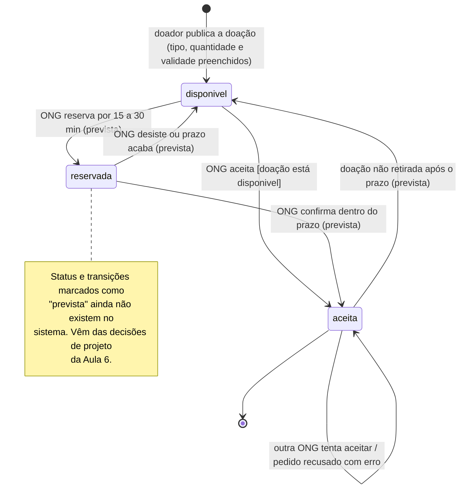

# Diagrama de Estados da Doação — versão original da IA

> **Versão gerada pela IA, sem correções.** Esta é a saída da primeira geração, mantida como saiu para servir de base à análise crítica (`../analise-critica.md`) e à versão final (`../estados-doacao.md`).

| Item | Valor |
|---|---|
| Ferramenta | Claude (modelo Claude Sonnet 5.5), app Claude |
| Data da geração | 21/10/2026 |
| Autor do commit | Miguel Angel Balladares Huertas (@miguettohuertas) |
| Entrada fornecida à IA | `docs/diagramas/contexto-ia.md`, e mais nada |
| Pedido | Gerar o Diagrama de Estados (UML) da Doação, em Mermaid, mostrando os status, o que dispara cada transição e as condições |

## Diagrama

## Descrição

A doação nasce com o status `disponivel` quando o doador publica os três campos obrigatórios. A ONG só pode aceitar uma doação que esteja `disponivel`; ao aceitar, o status passa a `aceita` e o nome da ONG é registrado. Se outra ONG tentar aceitar uma doação que já está `aceita`, o pedido é recusado e o status não muda.

As transições marcadas como "prevista" (`reservada` e a volta de `aceita` para `disponivel` por falta de retirada) são decisões de projeto ainda não implementadas e estão separadas do que existe hoje.
