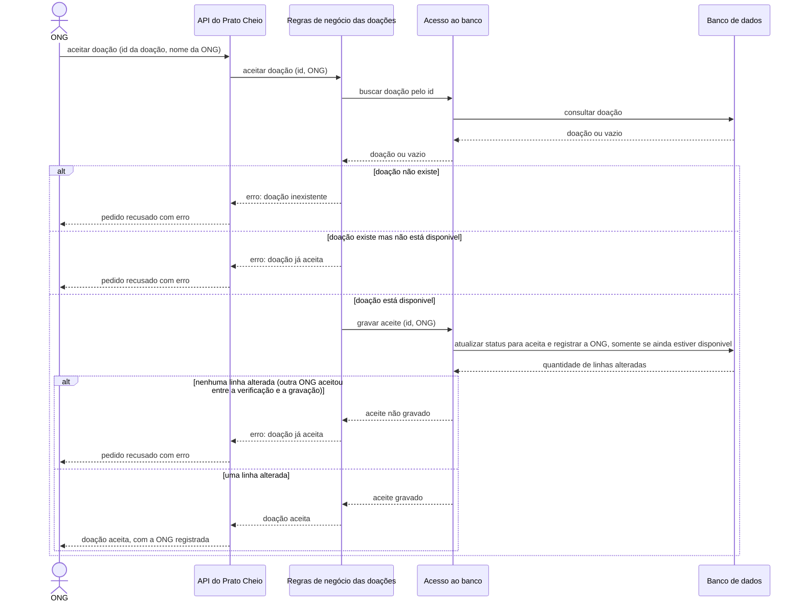

# Diagrama de Sequência do aceite de uma doação — versão original da IA

> **Versão gerada pela IA, sem correções.** Esta é a saída da primeira geração, mantida como saiu para servir de base à análise crítica (`../analise-critica.md`) e à versão final (`../sequencia-aceite-doacao.md`).

| Item | Valor |
|---|---|
| Ferramenta | Claude (modelo Claude Sonnet 5.5), app Claude |
| Data da geração | 21/10/2026 |
| Autor do commit | Miguel Angel Balladares Huertas (@miguettohuertas) |
| Entrada fornecida à IA | `docs/diagramas/contexto-ia.md`, e mais nada |
| Pedido | Gerar o Diagrama de Sequência (UML) do aceite de uma doação por uma ONG, em Mermaid, com o caminho feliz e os caminhos de erro |

## Diagrama

## Descrição

A ONG pede à API para aceitar uma doação. A API repassa o pedido às regras de negócio, que primeiro buscam a doação pelo banco. Se ela não existe, ou se já não está `disponivel`, o pedido é recusado com erro.

Se a doação está `disponivel`, as regras mandam gravar o aceite, e o acesso ao banco só atualiza a doação se ela ainda estiver `disponivel`. Isso cobre o caso em que outra ONG aceita a mesma doação entre a verificação e a gravação: nenhuma linha é alterada e o pedido também é recusado. Se uma linha é alterada, o aceite é confirmado para a ONG.
