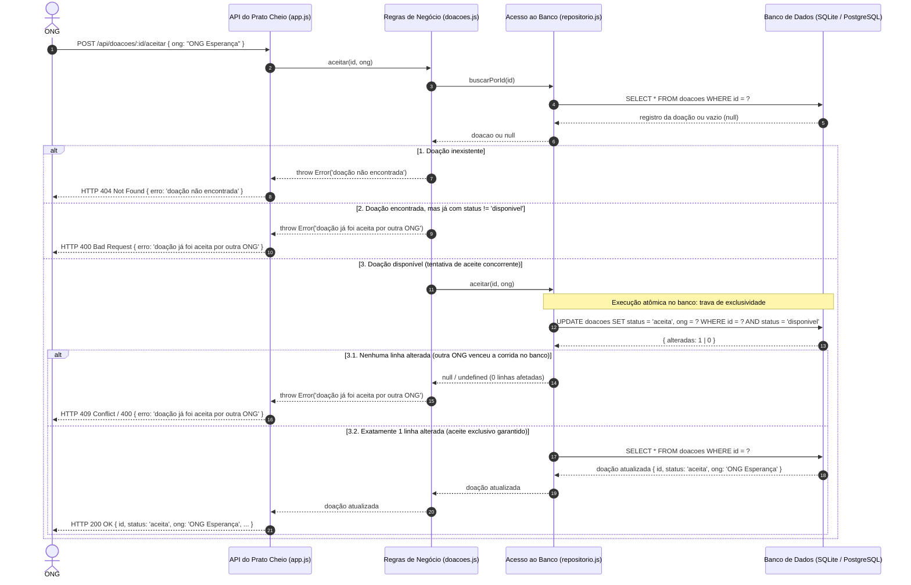

# Diagrama de Sequência do Aceite de uma Doação — Versão Final Evoluída

> **Versão evoluída e corrigida por Leonardo Lotério de Lima (@leonardosth).**  
> Este documento apresenta a versão final do Diagrama de Sequência da operação mais crítica do **Prato Cheio**: o aceite de doação por uma ONG. O modelo incorpora as correções e melhorias detalhadas na [análise crítica](analise-critica.md) sobre a [versão original gerada pela IA](ia-original/sequencia-aceite-doacao.md), explicitando o tratamento de erros HTTP e a garantia de concorrência atômica no banco de dados.

| Item | Valor |
|---|---|
| **Responsável pela evolução** | Leonardo Lotério de Lima (@leonardosth) |
| **Data da revisão** | 24/10/2026 |
| **Origem da versão inicial** | Claude Sonnet 5.5 (`ia-original/sequencia-aceite-doacao.md`) |
| **Referência crítica** | `docs/diagramas/analise-critica.md` (Problemas 1 e 2) |
| **Formato e modelagem** | Mermaid (UML Sequence Diagram) versionado no GitHub |

---

## 1. Correções e Melhorias Aplicadas

Conforme apontado na análise crítica ([analise-critica.md](analise-critica.md)), foram corrigidos os dois pontos de fragilidade da versão inicial:

1. **Diferenciação e detalhamento das respostas de erro da API:**
   - *Problema original:* A IA utilizava a mensagem genérica `pedido recusado com erro` para qualquer falha, sem distinguir causa nem código HTTP.
   - *Correção aplicada:* Foram diferenciados os três cenários de resposta com mensagens e status HTTP correspondentes:
     - **Doação inexistente:** `HTTP 404 Not Found` com payload `{ erro: "doação não encontrada" }`.
     - **Doação já indisponível no check inicial:** `HTTP 400 Bad Request` com payload `{ erro: "doação já foi aceita por outra ONG" }`.
     - **Concorrência (corrida perdida na gravação):** `HTTP 409 Conflict` (ou `HTTP 400`) informando que outra instituição concluiu o aceite simultâneo.

2. **Detalhamento explícito da garantia de concorrência no Banco de Dados:**
   - *Problema original:* O diagrama não deixava claro como duas ONGs consultando uma doação ao mesmo tempo não conseguiam ambas aceitá-la, nem como o número de linhas alteradas protegia o sistema.
   - *Correção aplicada:* O diagrama evidencia que a consulta inicial (`buscarPorId`) é apenas uma validação rápida (*fail-fast*). A verdadeira garantia de atomicidade ocorre na instrução SQL:
     ```sql
     UPDATE doacoes SET status = 'aceita', ong = ? WHERE id = ? AND status = 'disponivel'
     ```
     O diagrama detalha a inspeção de linhas afetadas (`alteradas`):
     - **`alteradas === 1`:** A transação foi a primeira a gravar. O aceite é confirmado e devolvido com sucesso (`HTTP 200`).
     - **`alteradas === 0`:** Outra transação alterou o status milissegundos antes; o banco não atualiza nada e a aplicação rejeita a segunda solicitação com erro de conflito.

---

## 2. Diagrama de Sequência Evoluído (Mermaid)



---

## 3. Rastreabilidade com a Implementação Real

A sequência evoluída reflete com fidelidade as camadas reais do código-fonte em `src/`:

1. **Camada HTTP (`src/app.js`):**
   - O endpoint `POST /api/doacoes/:id/aceitar` recebe o identificador nos parâmetros da URL e o corpo JSON com o nome da instituição (`req.body.ong`).
   - Captura exceções e repassa o código de status HTTP e a mensagem descritiva de erro correspondente.

2. **Camada de Domínio / Regras de Negócio (`src/doacoes.js`):**
   - Executa a validação de existência: `if (!doacao) throw new Error('doação não encontrada');`
   - Executa o check preliminar de disponibilidade: `if (doacao.status !== 'disponivel') throw new Error(ERRO_JA_ACEITA);`
   - Dispara a tentativa de gravação via repositório.

3. **Camada de Persistência (`src/repositorio.js`):**
   - Implementa a garantia de concorrência por meio da cláusula condicional de status:
     ```javascript
     const { alteradas } = await query(
       `UPDATE doacoes SET status = 'aceita', ong = ? WHERE id = ? AND status = 'disponivel'`,
       [ong, id]
     );
     if (alteradas === 0) return undefined;
     return buscarPorId(id);
     ```
   - Essa abordagem elimina qualquer possibilidade de *dirty read* ou duplicação de aceite, tanto no SQLite quanto na migração para PostgreSQL (ADR-0002).
