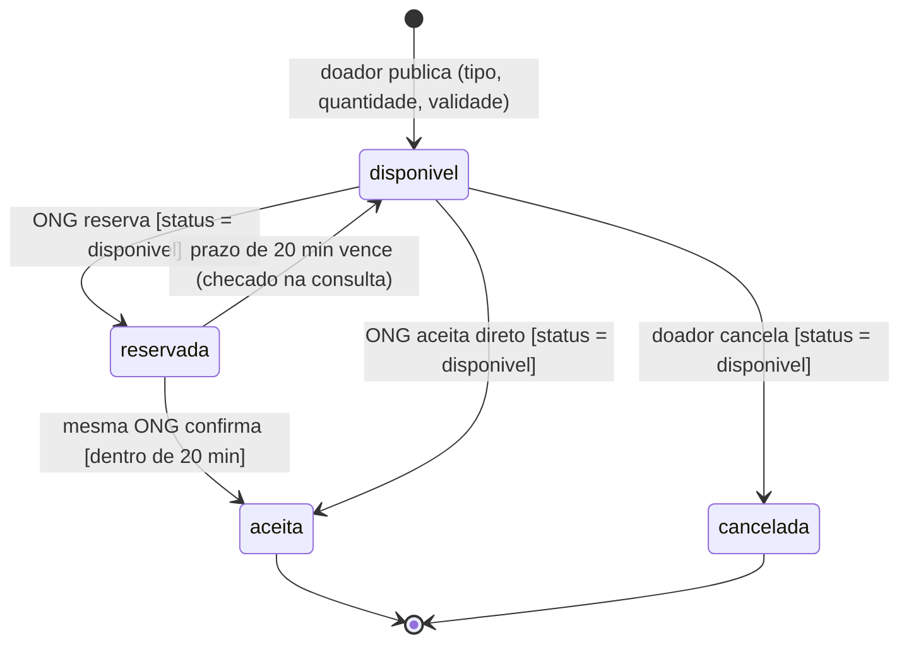

# Documento de Projeto — Prato Cheio

*Entrega 2 (N2) · Evolução do Projeto Prato Cheio · branch de entrega: `entrega-2`*

> **Rascunho** feito por Miguel Balladares Huertas (@miguettohuertas). Os itens marcados com
> `TODO` ficam para o grupo completar e revisar no PR.

## 1. Histórias implementadas nesta entrega

As histórias 1 a 3 (publicar, listar e aceitar) são o walking skeleton da Unidade 1 e estão em
[`docs/analise.md`](analise.md). Nesta entrega o grupo implementou duas histórias novas.

| # | História | Responsável | PR | Testes |
|---|---|---|---|---|
| 4 | Como **ONG**, quero reservar uma doação disponível por um prazo curto e depois confirmar, para organizar a retirada sem perder a doação para outra instituição. | Leonardo Lotério de Lima | #10 | `reservar e confirmar doação` (8 testes) |
| 5 | Como **doador**, quero cancelar uma doação que ainda está disponível, para impedir que uma ONG reserve um alimento que não pode mais ser doado. | Miguel Angel Balladares Huertas | `TODO: nº do PR` | `doador cancela uma doação` (10 testes) |

A história 5 é a versão refinada da história gerada por IA na Aula 3 (`user-stories.md`, "Gerenciamento
Completo de Doações"), reduzida só ao cancelamento.

### Critérios de aceite — História 4 (reserva com prazo)

1. Dado uma doação `disponivel`, quando uma ONG a reserva, então ela passa a `reservada`, com a ONG e o horário da reserva registrados, e sai da lista de disponíveis.
2. Dado uma doação inexistente, ou já reservada ou aceita, quando uma ONG tenta reservá-la, então o pedido é recusado com erro 400.
3. Dado uma doação reservada, quando a mesma ONG confirma dentro do prazo, então ela passa a `aceita`.
4. Dado uma doação reservada, quando outra ONG tenta confirmar, então o pedido é recusado com erro 400.
5. Dado uma reserva com mais de 20 minutos, quando a doação é consultada, então ela volta a `disponivel` e outra ONG pode reservá-la.
6. Dado duas ONGs reservando a mesma doação ao mesmo tempo, então só uma consegue.

### Critérios de aceite — História 5 (cancelamento pelo doador)

1. Dado uma doação `disponivel`, quando o doador a cancela, então ela passa a `cancelada`, com a data do cancelamento e o motivo (opcional) registrados.
2. Dado uma doação cancelada, quando uma ONG consulta a lista, então ela não aparece.
3. Dado uma doação cancelada, quando uma ONG tenta reservá-la ou aceitá-la, então o pedido é recusado com erro 400 e a mensagem "doação foi cancelada pelo doador".
4. Dado uma doação com reserva ativa ou já aceita, quando o doador tenta cancelar, então o pedido é recusado com erro 400 e a reserva ou o aceite continuam valendo.
5. Dado uma doação inexistente ou já cancelada, quando o doador tenta cancelar, então o pedido é recusado com erro 400.
6. Dado uma reserva que já expirou, quando o doador cancela, então o cancelamento é aceito (a doação já voltou a `disponivel`).
7. Dado um cancelamento e uma reserva chegando ao mesmo tempo, então só um dos dois acontece.

Rota: `POST /api/doacoes/:id/cancelar`, corpo opcional `{ "motivo": "..." }`. Na tela, cada doação da
lista ganhou o botão "Cancelar doação (doador)".

**Limitação conhecida:** como ainda não há autenticação (fora do escopo, ver `docs/analise.md`), o sistema
não verifica se quem cancela é o doador que publicou. Isso fica registrado, não esquecido.

## 2. Ciclo de vida da doação depois desta entrega

Diagramas completos da atividade anterior: [`docs/diagramas/`](diagramas/README.md).
`TODO (grupo):` decidir se atualizamos `docs/diagramas/estados-doacao.md` com o estado `cancelada`.

## 3. Decisões de projeto

| # | Decisão | Alternativas | O que motiva | Onde está no código |
|---|---|---|---|---|
| 1 | Toda mudança de status é um `UPDATE ... WHERE status = '<esperado>'` (lock otimista) | Lock pessimista / transação explícita; checar só na regra de negócio | Risco "duas ONGs aceitam a mesma doação" (`analise.md`) | `src/repositorio.js`: `aceitar`, `reservar`, `confirmarReserva`, `cancelar` |
| 2 | Reserva com prazo de 20 min antes do aceite (Decisão 2, Aula 6) | Manter só o aceite imediato | ONG precisa de tempo para organizar a retirada | `reservar`, `confirmarReserva` e as colunas `reservada_por` e `reservada_em` |
| 3 | Expiração "preguiçosa": a reserva vencida é liberada quando alguém consulta, sem agendador | Job/cron em paralelo | Orçamento ~zero, sem infraestrutura nova | `atualizarExpiradas()`, chamada antes de cada leitura e escrita |
| 4 | Cancelar só é permitido em `disponivel` | Permitir cancelar também `reservada` (avisando a ONG) | Não tirar o alimento de uma ONG que já se comprometeu; não há canal de aviso | `cancelar()` em `src/doacoes.js` |
| 5 | Cancelamento é um status (`cancelada`), não um `DELETE` | Apagar a linha | Rastreabilidade pedida pela vigilância sanitária (`analise.md`) | colunas `cancelada_em` e `motivo_cancelamento` |
| 6 | Migrar de SQLite para PostgreSQL | Manter SQLite, MySQL, MongoDB | Concorrência, banco fora da máquina, exigência da disciplina | ADR-0002 e ADR-0003 (ainda não implementado no código) |

### Trade-offs — Decisão 4 (o que pode ser cancelado)

| Critério | A: só `disponivel` (escolhida) | B: `disponivel` e `reservada` |
|---|---|---|
| Proteção da ONG que reservou | Total: a reserva sempre vale até vencer ou ser confirmada | Nenhuma: a ONG pode perder a doação enquanto organiza a retirada |
| Liberdade do doador | Menor: espera a reserva vencer (no máximo 20 min) | Maior: cancela a qualquer momento |
| Exige algo que não temos | Nada | Avisar a ONG (não há notificação nem contato no sistema) |
| Complexidade e teste | Uma condição no `UPDATE` | Duas condições, mais o caso de corrida com a confirmação |

## 4. ADRs

Ver [`docs/adr/`](adr/).

| ADR | Assunto | Status |
|---|---|---|
| 0001 | Escolha da stack | Aceita |
| 0002 | **Migração de SQLite para PostgreSQL** (ADR obrigatória) | Aceita, parcialmente substituída pela 0003 |
| 0003 | Revisão do banco para várias cidades (hospedagem gerenciada) | Aceita |
| 0004 | `TODO (grupo):` reserva com prazo e expiração preguiçosa (Decisões 2 e 3 acima) | A escrever |

`TODO (grupo):` a ADR-0002 diz que a troca de banco "fica contida no `db.js`" e cita "os 6 testes". Hoje
são 24 testes, e o `repositorio.js` usa SQL que só funciona no SQLite (marcador `?` e
`datetime('now', '+20 minutes')`), então a migração também vai mexer nele. Vale atualizar a ADR para ficar
coerente com o código.

## 5. Requisitos não funcionais

| # | Requisito | Como afeta o design | Como verificamos |
|---|---|---|---|
| RNF1 | **Consistência sob concorrência:** uma doação nunca pode ter dois destinos (duas ONGs, ou reservada e cancelada ao mesmo tempo), mesmo com pedidos simultâneos. | Toda transição de status é um único `UPDATE` condicional, e a regra de negócio confere `alteradas`. A checagem feita antes do `UPDATE` não basta sozinha. Também é um dos motivos para ir ao PostgreSQL (MVCC, ADR-0002). | Testes com `Promise.all`: corrida de reserva e corrida cancelar x reservar. |
| RNF2 | **Custo de infraestrutura ~zero:** o piloto não pode depender de serviço pago nem de processo extra rodando. | Expiração da reserva feita na consulta (`atualizarExpiradas`) em vez de cron ou fila; SQLite embutido agora e PostgreSQL em Docker local no desenvolvimento (Decisão 3, Aula 6; ADR-0003). Custo aceito: toda leitura faz também uma escrita. | `npm test` e o CI rodam sem nenhum serviço externo. |
| RNF3 | **Rastreabilidade do alimento:** precisa ser possível saber o que aconteceu com cada doação e quando (pedido da vigilância sanitária em `analise.md`). | Nada é apagado: cancelamento vira status com `cancelada_em` e `motivo_cancelamento`; reserva guarda `reservada_por` e `reservada_em`; aceite guarda a `ong`. | Testes conferem que data e motivo do cancelamento e dono da reserva ficam gravados. |

## 6. Critérios de validação do projeto

- `npm test` passa: 24 testes, cobrindo sucesso e erro de cada operação.
- O CI do GitHub Actions fica verde em todo PR (testes + aplicação subindo em `/api/saude`).
- Todo PR é integrado só depois de um "Approve" de outro integrante.
- Demo no vídeo: publicar → reservar → confirmar; publicar → cancelar → tentar reservar (erro).
- `TODO (grupo):` revisar/completar.

## 7. Uso de IA

- **História 5 e este rascunho:** Miguel Balladares usou o Claude (modelo Claude Opus 5.5) para implementar o cancelamento, escrever os testes e rascunhar este documento a partir do código e dos documentos do repositório. A escolha da história, das regras (só cancelar `disponivel`, manter o registro em vez de apagar) e a revisão foram do integrante.
- `TODO (grupo):` cada integrante acrescenta como usou IA nas suas partes (reserva, ADRs, diagramas).
